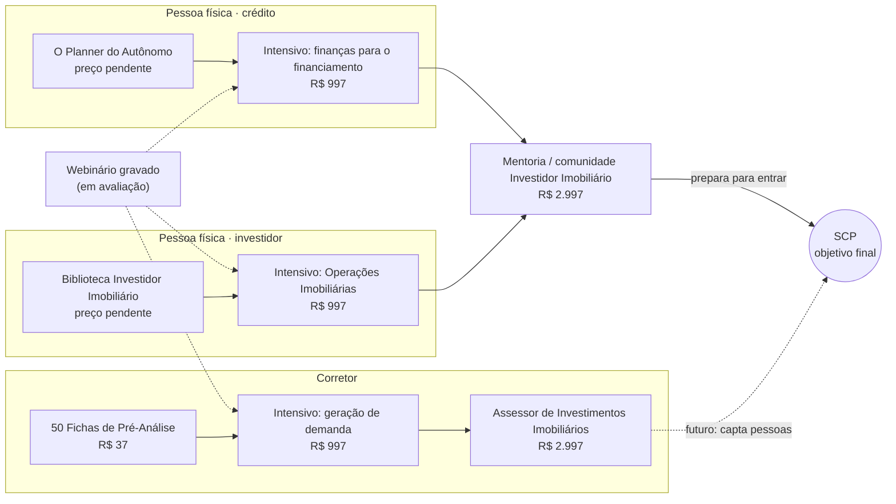
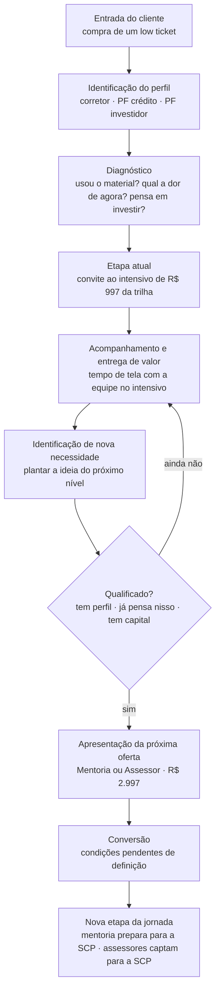

# Esteira de produtos e fluxograma de ascensão

A ficha completa de cada produto, com os onze campos (perfil, momento, problema, transformação, entregáveis, argumento, qualificação, objeções, prontidão, próxima ascensão), está no Módulo 03 e no Módulo 05 da interface (`index.html`). Aqui ficam a visão de conjunto e os fluxogramas.

## Esteira

Fora desta versão: 50 Projetos de Casas Populares (“o do Stefano”) e o perfil Assessor de Investimentos, que ainda não tem low ticket.

## Fluxo de ascensão

Passos 1, 2, 4, 5, 6, 7, 8 e 10 têm base no vídeo. O passo 3 (diagnóstico) é sugestão: o vídeo só diz que “os especialistas vão conseguir conduzir melhor as dores dele”. O passo 9 (conversão) está pendente.

## Princípio

A ascensão acompanha a maturidade do cliente. O vídeo usa o verbo “plantar”: a equipe alinha quem “já pensa nisso” e prepara a pessoa para o próximo nível, “às vezes começando devagar”. Quem ainda não tem perfil continua recebendo valor no degrau em que está.
